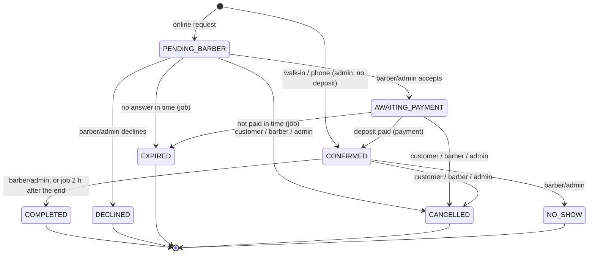

# Backend — booking API

The REST API for the barbershop template:

- Java 21, Spring Boot 3.5, Maven
- PostgreSQL 17 with Flyway migrations
- Spring Security: short-lived JWT access tokens + rotating refresh token in an httpOnly cookie
- Spring Mail + Thymeleaf: localized HTML + plain-text emails (DE/EN), Mailpit locally
- **Payments: DEMO ONLY.** No real provider is connected. See [Payments](#payments-demo-only).

Windows, no bash: **[TESTING-WINDOWS.md](TESTING-WINDOWS.md)** has copy-paste PowerShell commands and two
end-to-end demo scripts (`infra/demo-flow.ps1`, `infra/demo-accounts.ps1`).

## Start

```bash
cp infra/.env.example infra/.env          # set the secrets
docker compose -f infra/docker-compose.yml up -d --build
./infra/smoke-test.sh                     # bash walkthrough  (Windows: infra/demo-flow.ps1)
```

| What | URL |
|---|---|
| API | http://localhost:8080 |
| Swagger UI | http://localhost:8080/swagger-ui.html (OpenAPI JSON: `/v3/api-docs`) |
| Mailpit (all outgoing mail) | http://localhost:8025 |
| Health | http://localhost:8080/actuator/health |

**Tests** (need Docker for Testcontainers):

```bash
./mvnw test      # 62 unit tests: state machine, pricing/loyalty/deposit, refund rule, deadlines, availability, .ics
./mvnw verify    # + 62 integration tests against Postgres + GreenMail (full flows, races, jobs, accounts …)
```

---

## Booking lifecycle



- **One place:** `booking/BookingStateMachine` holds the complete transition table (from × to × actor).
  `Booking.transitionTo()` is the only status setter, and `BookingLifecycle` is the only service that calls it.
  `BookingLifecycle` also does the side effects: loyalty, deposit refund/forfeit, invalidating email links,
  and the events for the emails. Every transition locks the booking row (`SELECT … FOR UPDATE`), so a
  barber's click, the expiry job and a payment can never race.
- **Slot blocking:** PENDING_BARBER, AWAITING_PAYMENT, CONFIRMED (and COMPLETED) block the slot. This is
  enforced by the database: `EXCLUDE USING gist (staff_id WITH =, tstzrange(start, end + buffer) WITH &&) WHERE status IN (…)`.
  DECLINED, EXPIRED, CANCELLED and NO_SHOW free it.
- **Deadlines (per tenant, defaults):**

  | Deadline | Default |
  |---|---|
  | Barber answer | 12 h after the request, at the latest 2 h before the appointment |
  | Deposit payment | 24 h after acceptance, at the latest 2 h before the appointment |

- **Deposit:** 10.00 € by default. It is deducted in the shop: `price_total − loyalty_discount − deposit = amount_due_at_shop`.
  The database enforces this equation with a CHECK constraint. With a deposit of 0 €, acceptance confirms the booking right away.
- **Refund rule:**

  | Who cancels | Deposit |
  |---|---|
  | Customer, ≥ 24 h before the appointment (exactly 24 h counts) | Refunded |
  | Customer, later | Forfeited (kept) |
  | Shop (barber / admin) | Always refunded. An admin can pass `refund=false`. |

  Customers can cancel **online until 2 h before** the start (`onlineCancelCutoffMin`); later the API answers
  `409 booking.cancel_too_late` ("please contact the shop"). Account deletion still cancels open bookings,
  under the normal refund rule.
  | NO_SHOW | Forfeited |

  Admins can also refund afterwards with `POST /api/admin/bookings/{id}/refund`.
- **Scheduled job** (`BookingJobs`, every minute, safe with several instances):
  1. Expire requests the barber did not answer in time.
  2. Expire acceptances that were not paid in time.
  3. Auto-complete CONFIRMED bookings 2 h after their end, unless they were marked NO_SHOW.
  4. Send the reminder 24 h before the appointment.

## Email links: GET shows, POST acts

Email scanners open links automatically. So **no GET ever changes anything**: a link opens a frontend
page that shows the booking, and only the page's confirm button sends a POST.

| Email link | Frontend page | API |
|---|---|---|
| Barber "Accept" / "Decline" | `/[locale]/barber/requests/[token]?action=accept\|decline` | `GET /api/public/barber-decision/{token}`, `POST …/accept`, `POST …/decline` |
| Customer "Pay now" | `/[locale]/pay/[token]` | `GET /api/public/payments/{token}`, `POST …/simulate`, `POST …/cancel` |
| Customer "Manage / cancel" | `/[locale]/booking/manage/[token]` | `GET /api/public/manage/{token}`, `POST …/cancel` |
| Confirm email | `/[locale]/account/verify/[token]` | `POST /api/public/auth/verify-email` |
| Reset password / barber invite | `/[locale]/account/reset-password/[token]` | `POST /api/public/auth/reset-password` |

How the tokens work:

- 256 random bits. The database stores only `HMAC-SHA256(server key, purpose + ":" + token)`.
- **Bound to their purpose:** a manage token is useless as a payment token.
- **Single use:** a token is consumed in the same transaction as the action.
- **Expiring:**

  | Token | Valid until |
  |---|---|
  | Decision | The barber deadline |
  | Payment | The payment deadline |
  | Manage | The end of the appointment |
  | Verify email | 24 h |
  | Reset password | 1 h |
  | Barber invite | 72 h |

- **Used or expired** → `410` with `code` `token.used` or `token.expired`, a localized `detail`, and the current
  `bookingStatus` (or `paymentStatus`), so the page can say e.g. "already accepted". **Unknown** → `404 token.invalid`.
- Status changes invalidate stale links, e.g. a cancellation kills the open payment link.

## Emails (DE/EN by the recipient's language; HTML + plain text; dark/gold)

| To | When | Content |
|---|---|---|
| Customer | Request received | Summary; the barber answers by *deadline*; manage link |
| Barber | New request | Customer, services, date/time, duration, note, loyalty info. At the end: **Accept** / **Decline** |
| Customer | Accepted | Pay the 10 € deposit within X h. **Pay now**. Demo-mode note |
| Customer | Declined | Barber's note. **Pick another time** |
| Customer | Confirmed | "All set"; full summary (total, discount, deposit paid, due at the shop); how to cancel; **.ics**; demo note |
| Barber | Payment received | Customer, services, time range, "10 € deposit paid" |
| Customer / barber | Cancelled | Refund info: refunded (simulated in demo) / kept / nothing paid |
| Customer | Refunded | After an admin refund override |
| Customer | Expired | "Barber did not answer in time" or "not paid in time". **Book again** |
| Customer | Reminder | 24 h before |
| Account | Verify, reset, invite, "already registered" | |

Barber emails go to the barber's own login. While a barber has no login yet, they go to the shop's admins.
All emails share one layout (`templates/mail/layout.html`), built from `MailContent` in `mail/BookingMails` /
`mail/AccountMails`. They are sent after the commit, asynchronously, so a mail failure never breaks a booking.

## Accounts

| Topic | Behaviour |
|---|---|
| Roles | CUSTOMER, BARBER and ADMIN, each scoped to one tenant. A BARBER login is linked to its staff profile. Admins create it with `POST /api/admin/staff/{id}/account`; the barber gets an invite email to set a password. |
| Register / login | Register needs consent and is stored with its version. Then verify the email; login works only after verification. |
| Sessions | Access token: JWT, 15 min, sent in the `Authorization` header. Refresh token: httpOnly cookie `bs_refresh`, `SameSite=Strict`, `Path=/api/auth`, 30 days. The cookie rotates on every refresh, and reusing an old cookie revokes the whole session family. The cookie endpoints also check the `Origin` header. |
| Passwords | BCrypt (cost 12), minimum 10 characters. Forgot/reset ends all sessions. Changing the password ends all other sessions and returns a fresh one. |
| No user enumeration | Register, forgot-password and resend-verification always return the same `202`. Unknown email, wrong password and locked account return the same `401`, and an unknown email still costs one BCrypt check. "Email not verified" (`403`) is only shown after a correct password. |
| Brute force | Per-IP rate limits, plus a lockout of 15 min after 5 failed logins in a row. |
| Guests | A guest gives name, email, phone and consent, and manages the booking only through the signed links in the emails. When the same email is registered **and verified**, earlier guest bookings are linked to the account. Completed ones count as loyalty visits. |
| GDPR | `GET /api/me/export` returns a JSON download. `POST /api/me/delete` (password required) cancels open future bookings (normal refund rule), anonymises all bookings (name → "Gelöschter Kunde", contact data removed, dates and amounts kept), and deletes the account, its tokens and loyalty. |

## Loyalty (accounts only)

- Every COMPLETED booking is one visit.
- After **10** completed visits, the **next** booking gets **50 %** off the services. Threshold and percent are set per tenant.
- **Reserved** when the booking is created, **released** on cancel/decline/expiry/no-show, **consumed** when COMPLETED.
  Then the counter starts a new cycle (`visits − threshold`).
- The account row is locked, so two parallel bookings can't both get the reward.
- `GET /api/me/loyalty` returns `visitsInCurrentCycle`, `threshold`, `nextDiscountAvailable` and `discountReserved`.
- Barbers see a one-line loyalty note in the request email and on the decision page.

## Payments (DEMO ONLY)

```
PaymentProvider (interface)            selected by payment.provider (env PAYMENT_PROVIDER)
├── createPayment(request) → providerRef + payment page URL
├── refund(payment)
└── parseEvent(payload, headers) → provider event (webhooks)
DemoPaymentProvider                    the only implementation today ("demo")
PaymentService.handlePaymentSucceeded(ref)   ← demo "Simulate payment" button AND future webhooks
PaymentLedger                          payment rows + payment_event audit trail (refunds, forfeits, overrides)
```

- **Flow:**
  1. The barber accepts → payment `UNPAID` plus a single-use payment link.
  2. The page `/[locale]/pay/[token]` shows the amount, a summary, the demo banner and two buttons:
     **Simulate payment** and **Cancel**. There are no card fields anywhere.
  3. `POST /api/public/payments/{token}/simulate` → `handlePaymentSucceeded`:
     - **idempotent:** a second call returns `alreadyProcessed: true`, with no second email;
     - **serialized:** the payment and booking rows are locked;
     - **late payments:** a payment for an expired or cancelled booking is refunded instead of resurrecting it.
- **Statuses:** `UNPAID`, `PAID`, `REFUNDED`, `FORFEITED`. Every change is recorded in `payment_event`.
  Refunds are simulated ("refund simulated in demo mode") and the refund email says so.
- **Safety guard:** with the `prod` profile and `payment.provider=demo`, the app **refuses to start**, unless
  `payment.demo.allow-in-prod=true` (`PAYMENT_DEMO_ALLOW_IN_PROD=true`) is set explicitly.
  In demo mode, payment emails carry a "DEMO MODE" note and `GET /api/public/{tenant}` returns `demoPayments: true`.
- No Stripe dependency, no keys, no Stripe CLI container.

### Adding a real provider later (e.g. Stripe)

1. **Dependency and config.** Add `com.stripe:stripe-java`, plus `STRIPE_SECRET_KEY` and `STRIPE_WEBHOOK_SECRET`
   as environment variables. Never commit them.
2. **`StripePaymentProvider implements PaymentProvider`**, with `id() = "stripe"` and `isDemo() = false`.
   - `createPayment`: create a **Checkout Session** with
     - `mode=payment` and one line item with the deposit amount,
     - `metadata.bookingId`,
     - `success_url` / `cancel_url` pointing back to `/[locale]/pay/[token]`,
     - `expires_at` set to the payment deadline (Stripe allows 30 min to 24 h).

     Return `session.id` as `providerRef` and `session.url` as the payment URL. Add a `payment_url` column, so
     the pay page can show a "Pay" button that redirects there instead of "Simulate payment".
   - `refund`: `Refund.create(payment_intent)`.
   - `parseEvent`: `Webhook.constructEvent(payload, headers["stripe-signature"], webhookSecret)`. Map
     `checkout.session.completed` (with `payment_status=paid`) to `ProviderEvent(event.id, PAYMENT_SUCCEEDED, session.id)`.
3. **Register it** in `PaymentConfig` (`case "stripe" -> …`) and set `PAYMENT_PROVIDER=stripe`.
4. **Webhook:** `POST /api/public/payments/webhook/stripe` already exists. It verifies the signature through the
   provider and calls the same idempotent `handlePaymentSucceeded`. `payment_event.provider_event_id` is unique,
   so Stripe's retries are applied once.
5. **Stripe Connect (one account per shop):**
   - Store `stripe_account_id` on the tenant and onboard each shop with Account Links (Express accounts).
   - Either create the session on the connected account (direct charge, `Stripe-Account` header), or use
     `payment_intent_data.transfer_data.destination` with an optional `application_fee_amount` (destination charge).
   - Subscribe the Connect webhook endpoint.
   - Refunds go to the same account.
6. Remove `PAYMENT_DEMO_ALLOW_IN_PROD`. The guard then no longer matters.

## API overview

`{tenant}` is the shop slug, e.g. `the-barber-news`. Full schema: Swagger UI.

**Public**

| | |
|---|---|
| `GET /api/public/{tenant}` | Shop info and customer-facing booking rules (deposit, refund cutoff, lead time …) |
| `GET /api/public/{tenant}/services`, `GET …/staff?service=` | Services and barbers |
| `GET /api/public/{tenant}/availability?services=a,b&date=` | One day for **all barbers**: `barbers[]` (one column each, only those offering all services; every schedule time with `available` true/false, taken = false) and `anyBarber[]` (free only) |
| `GET /api/public/{tenant}/availability/days?services=&staff=&from=&to=` | Days with free slots |
| `POST /api/public/{tenant}/bookings/price-preview` | Total, loyalty discount (logged-in customers), deposit, due at shop |
| `POST /api/public/{tenant}/bookings` | Request (guest or logged-in). `201 PENDING_BARBER`; `409` slot taken; `422` invalid slot — the response carries a one-time `statusToken` |
| `GET /api/public/booking-status/{token}`, `POST …/payment-link` | Status page right after booking (read-only, reusable until a week after the appointment); a fresh single-use payment link while AWAITING_PAYMENT |
| `…/manage/{token}`, `…/barber-decision/{token}`, `…/payments/{token}` | Email-link pages, see above |
| `POST /api/public/{tenant}/auth/register` · `…/resend-verification` · `…/forgot-password` | Always `202` |
| `POST /api/public/auth/verify-email` · `…/reset-password` | Token from the email |

**Session** (`/api/auth`; these endpoints set the refresh cookie)

| | |
|---|---|
| `POST /api/auth/{tenant}/login` | Any role → access token + cookie |
| `POST /api/auth/refresh`, `POST /api/auth/logout` | Cookie |
| `POST /api/auth/password` | Change password (Bearer) |

**Customer** (`/api/me`, Bearer)

| | |
|---|---|
| `GET`, `PATCH /api/me` | Profile |
| `GET /api/me/bookings?scope=upcoming\|past`, `GET …/{id}`, `POST …/{id}/cancel` | My bookings |
| `POST /api/me/bookings/{id}/payment-link` | "Pay now": fresh payment link while AWAITING_PAYMENT |
| `GET /api/me/loyalty` | Loyalty state |
| `GET /api/me/export`, `POST /api/me/delete` | GDPR |

**Barber** (`/api/barber`, role BARBER, own bookings only)

| | |
|---|---|
| `GET /api/barber/calendar?date=&view=day\|week` | Calendar |
| `GET /api/barber/requests` | Pending requests |
| `GET /api/barber/bookings/{id}` | One booking |
| `POST …/{id}/accept\|decline\|complete\|no-show\|cancel` | Transitions |

**Admin** (`/api/admin`, role ADMIN, own tenant only)

| | |
|---|---|
| `GET /api/admin/bookings` | Filter by `from`, `to`, `staffId`, `status`, `q`, with paging. Views include `allowedTransitions` and payment |
| `POST /api/admin/bookings` | Manual walk-in / phone booking: CONFIRMED, no deposit |
| `POST /api/admin/bookings/{id}/accept\|decline\|complete\|no-show\|cancel\|refund` | Transitions; `cancel` takes `{refund?}`, `refund` is the override |
| `GET /api/admin/customers?q=` | Accounts and guests with completed visits and loyalty |
| `GET`, `PUT /api/admin/settings` | Booking policy (see below) |
| `POST /api/admin/staff/{id}/account` | Barber login (invite email) |
| `/api/admin/services`, `/api/admin/staff` (+ `/services`, `/working-hours`), `/api/admin/time-off`, `/api/admin/stats` | As in phase 2 |

Errors are RFC 9457 problem details with a stable `code` and a localized `detail`. Validation errors also have
`errors: {field: message}`.

## Configuration

**Per tenant** (columns on `tenant`; `GET`/`PUT /api/admin/settings`; all values in minutes / cents / percent):

| Setting | Default |
|---|---|
| `barberResponseMin` | 720 (12 h) |
| `paymentDeadlineMin` | 1440 (24 h) |
| `deadlineBeforeStartMin` | 120 (both deadlines end ≥ 2 h before the appointment) |
| `depositCents` | 1000 |
| `refundCutoffMin` | 1440 |
| `onlineCancelCutoffMin` | 120 (customers cancel online until 2 h before; later: contact the shop) |
| `loyaltyThreshold` | 10 |
| `loyaltyPercent` | 50 |
| `slotStepMin` | 15 |
| `bufferMin` | 0 |
| `minLeadMin` | 240 (bookable from 4 h ahead) |
| `maxDaysAhead` | 60 |
| `autoCompleteAfterMin` | 120 |
| `reminderBeforeMin` | 1440 |

**Environment** (all documented in `infra/.env.example`):

| Variable | Meaning |
|---|---|
| `DB_URL`, `DB_USERNAME`, `DB_PASSWORD` | Database |
| `APP_JWT_SECRET` | **Required**, ≥ 32 bytes. Signs access tokens. Email-link tokens use a derived key unless `APP_TOKEN_SECRET` is set. |
| `APP_ADMIN_EMAIL`, `APP_ADMIN_PASSWORD`, `APP_ADMIN_TENANT` | Bootstrap admin, created if missing |
| `APP_FRONTEND_BASE_URL`, `APP_CORS_ALLOWED_ORIGINS` | Base for email links; allowed browser origins |
| `APP_COOKIE_SECURE` | `true` behind HTTPS (the `prod` profile defaults to `true`) |
| `APP_JOBS_ENABLED`, `APP_JOBS_INTERVAL` | Scheduled job (default on, every minute) |
| `APP_RATE_LIMIT_BOOKINGS` / `_LOGIN` / `_AUTH_MAIL` / `_TOKEN_ACTIONS` / `_REFRESH` | Per-IP limits: 10/min, 5/min, 5 per 10 min, 20/min, 30/min |
| `APP_BOOKING_MAX_OPEN_REQUESTS` | Open requests per email (anti-spam), default 3 |
| `PAYMENT_PROVIDER`, `PAYMENT_DEMO_ALLOW_IN_PROD` | `demo`; the prod guard switch |
| `SMTP_*`, `APP_MAIL_FROM` | Mail server (Mailpit locally) |
| `SPRING_PROFILES_ACTIVE` | `demo` loads the demo shop; `prod` hardens it (secure cookie, no Swagger) |

Frontend link paths (`app.links.*` in `application.yml`): `/{lang}/booking`, `/{lang}/booking/manage/{token}`,
`/{lang}/pay/{token}`, `/{lang}/barber/requests/{token}`, `/{lang}/account/verify/{token}`,
`/{lang}/account/reset-password/{token}`, `/{lang}/account`.

## Code structure (package by feature, `com.barbershop.*`)

| Package | Contents |
|---|---|
| `booking` | `Booking` + `BookingItem`; `BookingStateMachine`; `BookingLifecycle` (all transitions); `BookingService` (create, preview, queries); `BookingLinkService` (email-link pages); `BookingRules` / `BookingPricing` (pure rules); `BookingJobs`; customer/barber/admin controllers; stats |
| `payment` | `PaymentProvider`, `DemoPaymentProvider`, `PaymentService` (`handlePaymentSucceeded`), `PaymentLedger`, prod guard (`PaymentConfig`) |
| `loyalty` | `LoyaltyRules` (pure), `LoyaltyService`, account row |
| `token` | Single-use email-link tokens (`ActionTokenService`, HMAC `TokenHasher`) |
| `auth` | Users and roles, JWT, refresh tokens, login/refresh/logout, lockout, security config, bootstrap admin |
| `account` | Register/verify/reset, profile, GDPR export/delete, guest linking, barber invites, customer list |
| `availability` | `AvailabilityCalculator` (pure: multiple services, buffer, DST) and the service around it |
| `mail` | `MailContent` + one layout; `BookingMails` / `AccountMails`; `.ics`; after-commit listeners |
| `tenant` | Tenant, `BookingPolicy` (per-tenant rules), settings endpoint |
| `service`, `staff` | Catalogue, barbers, working hours, time off |
| `common` | Config, i18n, errors (RFC 9457), rate limiting, frontend links |

## Double booking protection

1. **Schedule check.** The start must be a real slot (working hours, time off, lead time, horizon, grid),
   otherwise **422**.
2. **Overlap check** against slot-blocking bookings, including the buffer → **409**.
3. **Database exclusion constraint** over `[start, end + buffer)` for all slot-blocking statuses. It is the final
   word under concurrency. With "any barber", the next free barber is tried; the least booked one that day goes first.

`BookingConcurrencyIT`: of 16 parallel requests for one barber and slot, exactly 1 succeeds. For "any barber",
exactly one per free barber succeeds.
Each insert attempt runs in its own transaction, and the reads before it hold no connection, so a booking rush
cannot exhaust the connection pool.

## Times

All instants are `timestamptz` (UTC). Working hours are local times in the tenant's timezone. The API returns
the local offset (`2026-10-20T10:00:00+02:00`). DST is covered by unit tests.
